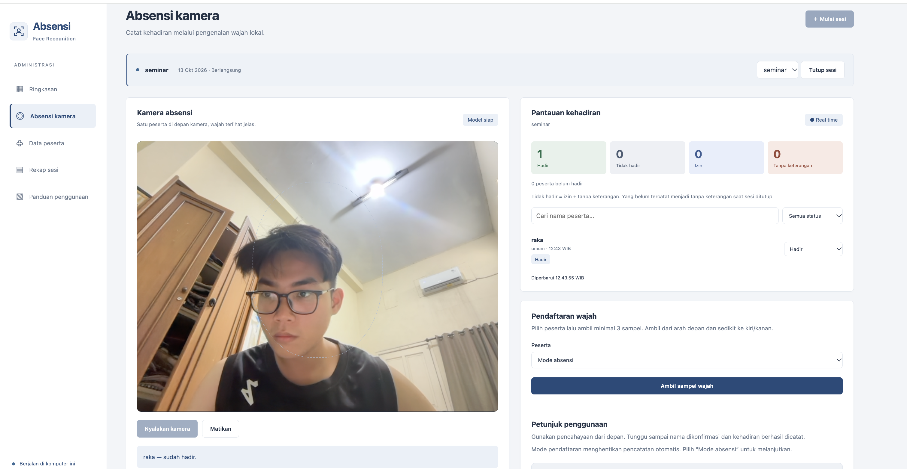
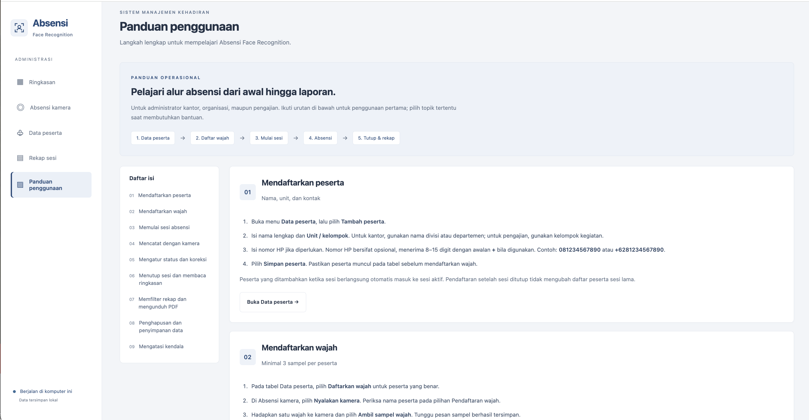

# Absensi Face Recognition

Aplikasi absensi berbasis pengenalan wajah untuk perkantoran, organisasi, dan pengajian. Dirancang untuk penggunaan lokal dengan kapasitas awal sekitar 100 peserta, dilengkapi pemantauan real time dan laporan PDF. Backend Python/FastAPI, SQLite, frontend HTML/CSS/JavaScript tanpa build, pengenalan OpenCV YuNet + SFace. Tidak memerlukan layanan cloud atau YOLO.

## Fitur

- Pendaftaran peserta, unit/kelompok, nomor HP opsional, dan 3–5 sampel wajah.
- Absensi melalui webcam dengan konfirmasi tiga kecocokan berturut-turut dan pencegahan pencatatan ganda.
- Absensi manual serta status hadir, izin, belum hadir, dan tanpa keterangan.
- Dashboard dan panel pemantauan yang diperbarui melalui WebSocket.
- Pengelolaan sesi, pencarian, filter hari/nama kegiatan, dan urutan tanggal atau nama.
- Unduhan PDF dengan nama kegiatan dan tanggal sesi pada laporan serta nama file.
- Penghapusan peserta, sesi, atau catatan absensi dengan konfirmasi.
- Retensi otomatis sesi selesai selama satu bulan kalender; data induk peserta tetap tersimpan.
- Panduan penggunaan dalam aplikasi dengan 9 bab dan bantuan kendala.

## Tampilan aplikasi

### Absensi kamera dan pemantauan real time



### Panduan penggunaan



## Teknologi

| Bagian | Teknologi |
| --- | --- |
| Backend | Python, FastAPI, Uvicorn |
| Pengenalan wajah | OpenCV YuNet dan SFace |
| Database | SQLite |
| Tampilan | HTML, CSS, JavaScript |
| Pembaruan langsung | WebSocket |
| Laporan | ReportLab |

## Persyaratan

- Python 3.10 atau lebih baru.
- Webcam dan browser yang mendukung akses kamera.
- Internet untuk instalasi pertama dan unduhan model; setelah itu penggunaan lokal dapat berjalan tanpa internet.
- Peluncur yang disertakan saat ini untuk **macOS**. Peluncur Windows belum disediakan.

## Menjalankan di macOS

Clone repositori lalu jalankan peluncur:

```sh
git clone https://github.com/raka6march/Absensi-Face-Recognition.git
cd Absensi-Face-Recognition
chmod +x start.command
./start.command
```

Jika sudah memiliki folder aplikasi, buka Terminal pada folder tersebut dan jalankan `./start.command`.

Python 3.10+ diperlukan. Peluncuran pertama memasang dependensi dan mengunduh model (~38 MB), sehingga membutuhkan internet. Peluncuran selanjutnya berjalan lokal/offline di http://localhost:8000. Jika tab awal belum terhubung, refresh setelah Terminal menampilkan server siap. Hentikan dengan Control+C di Terminal. Server hanya mendengarkan loopback komputer ini.

## Cara menggunakan

1. Tambahkan data peserta pada **Data peserta**, termasuk nomor HP opsional (8–15 digit; awalan + diperbolehkan).
2. Pilih **Daftarkan wajah**, nyalakan kamera, lalu ambil 3–5 sampel per orang dengan variasi sudut kecil. Pendaftaran tidak memerlukan sesi aktif. Beri izin kamera di browser.
3. Mulai sesi. Daftar peserta saat itu menjadi daftar peserta sesi; peserta baru yang ditambahkan saat sesi aktif otomatis masuk sesi tersebut.
4. Pada kamera, pilih **Mode absensi**. Hadapkan satu wajah ke kamera. Tiga kecocokan berturut-turut mencatat kehadiran satu kali per sesi.
5. Gunakan **Catat hadir** untuk absensi manual dan **Hapus catatan** untuk membatalkan catatan pada sesi yang dipilih.
6. Tutup sesi. Status yang belum tercatat berubah menjadi tanpa keterangan; status izin tetap tersimpan. Panel di kanan kamera menampilkan jumlah hadir, tidak hadir (izin + tanpa keterangan), izin, tanpa keterangan, serta daftar peserta yang bisa dicari dan difilter. Administrator dapat mengubah status melalui pilihan pada setiap peserta selama sesi aktif. Jika peserta berstatus izin kemudian hadir lewat kamera, status otomatis berubah menjadi hadir. Unduh PDF pada **Rekap sesi**. PDF sesi aktif merupakan rekap sementara.

Tanggal dan jam menggunakan Asia/Jakarta. Tidak ada data peserta contoh. Diagram persentase dan tabel diperbarui melalui WebSocket. Kamera diproses berkala (~650 ms setelah hasil sebelumnya); bukan seluruh frame video. Model berjalan melalui OpenCV CPU; tidak mengklaim akselerasi GPU M5.

## Data dan batasan

Data disimpan dalam `data/absensi.sqlite3`, termasuk embedding wajah, bukan foto/video. Daftarkan wajah atas persetujuan peserta/wali. Embedding tetap data biometrik; batasi akses akun macOS dan backup folder data dengan aman. Reset wajah tersedia di tabel peserta. Backup database ketika server berhenti.

Ini prototipe yang perlu diuji pada kamera, pencahayaan, dan peserta sebenarnya. Threshold cosine 0.50 dan margin 0.08 sengaja konservatif tetapi bukan jaminan akurasi. Jangan gunakan statistik ini sebagai pengukuran akurasi model. Belum ada liveness/anti-spoofing, autentikasi multiuser, atau rekap bulanan gabungan. Administrator perlu mengawasi kamera dan menyediakan absensi manual. Kamera browser menggunakan localhost; membuka dari jaringan membutuhkan konfigurasi HTTPS dan autentikasi tambahan.

Model berasal dari OpenCV Zoo:
- https://github.com/opencv/opencv_zoo/tree/main/models/face_detection_yunet
- https://github.com/opencv/opencv_zoo/tree/main/models/face_recognition_sface

Lisensi model disertakan oleh skrip unduhan di `models/`. Model dan database tidak dimasukkan ke Git.

## Pengujian

```sh
.venv/bin/pip install pytest httpx
.venv/bin/python -m pytest -q
```

Untuk memeriksa penghapusan dan retensi secara terpisah:

```sh
.venv/bin/python check_deletion.py
.venv/bin/python check_retention.py
```

Pengujian memakai database sementara: duplikasi, snapshot peserta sesi, koreksi, penutupan sesi, ekspor PDF multipage, validasi, dan pengiriman event real time. Ketepatan identifikasi/liveness tetap memerlukan uji kamera nyata.

## Menghapus data

- **Data peserta → Hapus peserta**: menghapus data induk, nomor HP, sampel wajah, dan seluruh catatan/status absensi serta keikutsertaan pada semua sesi. Statistik sesi terkait akan berubah.
- **Rekap sesi → Hapus sesi** atau tombol yang sama di **Ringkasan**: menghapus sesi beserta semua daftar peserta dan catatan/statusnya; data induk peserta tetap tersimpan.
- **Ringkasan → Hapus catatan**: menghapus kehadiran/status satu peserta pada sesi terpilih; tetap mempertahankan data induk dan peserta sesi. Status kembali menjadi belum hadir untuk sesi aktif, atau tanpa keterangan untuk sesi selesai.

Semua tindakan di atas meminta konfirmasi dan bersifat permanen. Tidak ada data yang dihapus hanya dengan membuka dialog atau memilih Batal. Jika kamera tetap aktif, wajah yang terlihat dapat tercatat kembali setelah catatan dihapus.

## Filter dan retensi sesi

Di Rekap Sesi, gunakan pencarian, filter hari yang disebut dalam nama kegiatan (misalnya **Senin** menampilkan “sambung senin” dan “ngaji senin”), filter nama sesi yang sama, serta urutan tanggal terbaru/terlama atau nama A–Z. Filter hari mengikuti nama sesi, bukan hari tanggal pelaksanaan. Reset filter mengembalikan seluruh daftar.

Sesi yang **sudah selesai** beserta roster, catatan kehadiran, dan status absensinya dihapus permanen **satu bulan kalender setelah waktu mulai sesi**. Contoh: sesi 13 September kedaluwarsa 13 Oktober pada jam yang sama; 31 Januari kedaluwarsa pada hari terakhir Februari. Sesi aktif dikecualikan. Data induk peserta, nomor HP, dan sampel wajah tetap tersimpan. Ringkasan dan Rekap Sesi memakai data yang sama dan otomatis mengikuti pembersihan.

Pembersihan dijalankan saat server mulai dan setiap 60 detik selama aplikasi berjalan; jika komputer/aplikasi mati, pembersihan dilanjutkan saat aplikasi berikutnya dijalankan. SQLite VACUUM dijalankan setelah penghapusan untuk mengecilkan file database. Unduh PDF yang perlu diarsipkan sebelum kedaluwarsa; file PDF yang sudah diunduh tidak dihapus aplikasi.

## Panduan dalam aplikasi

Menu **Panduan penggunaan** berada di bawah Rekap sesi. Panduan menyediakan daftar isi, 9 bab berurutan, dimulai dari pendaftaran peserta, tabel arti status, bantuan kendala yang dapat dibuka, serta daftar periksa kegiatan. Tombol menuju Data peserta, Absensi kamera, dan Rekap sesi tersedia di bagian terkait.

## Isi repositori

```text
app.py                 Backend, database, pengenalan wajah, dan ekspor PDF
static/                Tampilan dan interaksi web
setup_models.py        Unduhan model dan lisensinya
start.command          Peluncur macOS
requirements.txt       Dependensi Python
test_app.py            Pengujian alur absensi
check_deletion.py      Pengujian penghapusan data
check_retention.py     Pengujian retensi sesi
docs/screenshots/      Contoh tampilan aplikasi
models/                Lisensi model; bobot diunduh saat instalasi
```

Database peserta, embedding wajah, lingkungan Python, dan bobot model tidak disertakan dalam repositori. Instalasi baru membuat database kosong secara otomatis.

## Catatan penggunaan

Aplikasi ini merupakan prototipe lokal. Sebelum deployment publik, diperlukan autentikasi administrator, pembatasan akses, HTTPS, backup, dan pengujian beban. Saat ini satu instalasi menggunakan satu daftar peserta bersama dan hanya satu sesi aktif. Lisensi model pihak ketiga berada pada folder `models/`; periksa ketentuannya sebelum penggunaan atau distribusi lanjutan.
